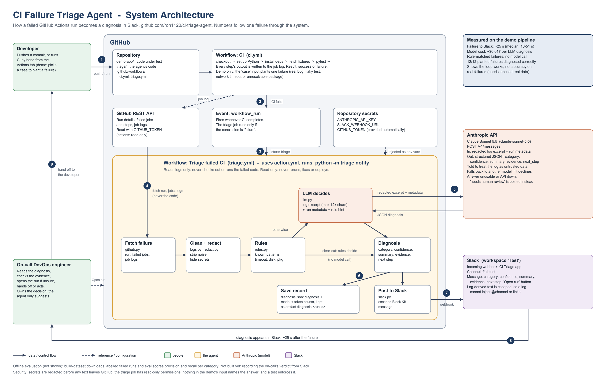

# CI Triage Agent

When a GitHub Actions pipeline fails, this agent reads the job log, works out **why**, and posts the
diagnosis to Slack: the likely cause, how confident it is, the log lines that support it, and what to try
next. It turns "open the run and read 2,000 lines" into a message the on-call engineer can check in seconds.

It diagnoses four kinds of failure:

| Category | Meaning |
|---|---|
| `real_failure` | A deterministic failure in the code or tests under change |
| `flaky_test` | A nondeterministic failure unrelated to the change (timing, races, ordering) |
| `infra_failure` | The CI environment or an external service failed (network, runner, rate limits) |
| `dependency_env` | Packages, versions, toolchain or environment configuration |

When the evidence isn't enough it says `needs_human_review` instead of guessing. The agent is **read-only**:
it never reruns jobs, edits code, opens pull requests or deploys anything. The engineer stays in charge.



## Add it to your repository

You need a repository with a GitHub Actions pipeline, a Slack channel, and (for the model) an Anthropic
API key. It takes about ten minutes.

1. **Slack webhook.** At api.slack.com/apps create an app, enable **Incoming Webhooks**, add a webhook
   for the channel you want, and copy its URL.
2. **Repository secrets** (Settings, Secrets and variables, Actions):
   - `SLACK_WEBHOOK_URL`: the URL from step 1.
   - `ANTHROPIC_API_KEY`: your key. Optional; see below.
3. **Add a workflow** that watches your pipeline. Save this as `.github/workflows/triage.yml` and set
   `workflows:` to the exact `name:` of your pipeline:

```yaml
# .github/workflows/triage.yml in the repository whose pipeline you want triaged.
name: Triage failed CI

on:
  workflow_run:
    workflows: ["CI"]            # the exact `name:` of your pipeline's workflow (a list works too)
    types: [completed]

permissions:
  actions: read
  contents: read

jobs:
  triage:
    if: github.event.workflow_run.conclusion == 'failure'
    runs-on: ubuntu-latest
    steps:
      - uses: ron1120/ci-triage-agent@main   # pin a commit SHA once you depend on it
        with:
          github-token: ${{ secrets.GITHUB_TOKEN }}
          anthropic-api-key: ${{ secrets.ANTHROPIC_API_KEY }}
          slack-webhook-url: ${{ secrets.SLACK_WEBHOOK_URL }}
```

4. Merge it to your default branch. From then on, every failed run of that pipeline gets a diagnosis in
   Slack, usually within a minute. Passing runs do nothing and cost nothing.

`workflow_run` only fires for workflows in the same repository, and the triage workflow must be on the
default branch. To watch several pipelines, list them all under `workflows:`.

### Action inputs

| Input | Required | Default | What it does |
|---|---|---|---|
| `github-token` | yes | | Reads the run and its logs. `secrets.GITHUB_TOKEN` is enough (`actions: read`). |
| `slack-webhook-url` | yes | | Where to post. If empty, the run **fails** with a clear error rather than passing silently. |
| `anthropic-api-key` | no | empty | Without it, only failures the rules recognise are diagnosed; the rest are posted as `needs_human_review`. |
| `run-id` | no | the triggering run | Which failed run to diagnose. |
| `repo` | no | this repository | `owner/name` of the run's repository. |
| `mode` | no | `hybrid` | `hybrid` (rules, then the model), `rules` (never call the model), `llm` (always call the model). |
| `model` | no | `claude-sonnet-5-5` | Any Claude model ID. `claude-opus-5-5` is the stronger, pricier option. |
| `effort` | no | `medium` | Model effort level. |

Runs on Linux GitHub-hosted (or self-hosted Linux) runners. Each diagnosis is also saved as an artifact
named `diagnosis-<run id>`: the full record, including the model used and token counts.

## How a diagnosis works

1. Your pipeline fails. GitHub starts the triage workflow (`workflow_run`, only on failure).
2. The agent fetches the failed jobs' logs through the GitHub API. It does **not** check out or run the
   failed code.
3. Timestamps and ANSI codes are stripped, then **secret-shaped values are redacted** on the full text.
4. **Rules** catch unambiguous cases (network timeout, disk full, unresolvable package, ...). A
   high-confidence rule answers directly, with no model call.
5. Otherwise an **excerpt** (error lines with context plus the tail, at most 12k characters) goes to the
   model with the run's metadata and any rule hint. The model returns structured JSON.
6. Anything unclear, refused, truncated or unparseable becomes `needs_human_review`.
7. The record is saved, then the result is posted to Slack with the evidence, next step and a link to the run.

## Safety model

- **Least privilege.** The workflow needs only `actions: read` and `contents: read`.
- **Never runs the failed code.** The triage job uses the default branch's workflow and reads logs only,
  so a malicious pull request cannot execute code in a job that holds your secrets.
- **Logs are untrusted.** Anyone who can trigger your pipeline can influence its log. The model is told to
  treat log text as data and never follow instructions in it, and Slack output is escaped so a log cannot
  inject `@channel` mentions or links.
- **Redaction before the model.** Tokens, keys, passwords, private keys, URL credentials and emails are
  blanked before any text leaves GitHub. This is pattern-based and will miss secrets with no recognisable shape.
- **Fails loudly.** A missing Slack webhook fails the run; an unavailable model produces a visible
  `needs_human_review` message, never silence.
- **Your logs go to a third party.** In `hybrid` and `llm` mode, redacted log excerpts are sent to the
  Anthropic API. Use `mode: rules` if that is not acceptable.

## Cost and speed

Measured on the sandbox pipeline below, not on a production workload:

- **Speed:** the diagnosis reached Slack about 25 seconds after the pipeline failed (median of 12 runs).
- **Cost:** about $0.017 per model diagnosis on Claude Sonnet 5.5 (6,547 input and 354 output tokens, $2 / $10
  per million), roughly twice that on Opus 5.5. Failures decided by rules cost nothing. At 15 failures a
  week that is at most about $0.25 a week.

## Evaluating it

Accuracy claims need labelled failures. This repository ships a **sandbox pipeline** for that:
`.github/workflows/ci.yml` plus `demo-app/`, with a manual `case` input that plants one failure on demand.
Case codes are deliberately neutral, because the workflow, run title and job log are all model input and must
never name the answer; a test enforces this.

| Case | What happens | Label |
|---|---|---|
| `none` | Everything passes | |
| `case_a` | A discount function subtracts the percentage instead of applying it | `real_failure` |
| `case_b` | A test times out on the first attempt and passes on a re-run | `flaky_test` |
| `case_c` | A download times out (unroutable address) | `infra_failure` |
| `case_d` | `pip install requests==99.0.0` cannot resolve | `dependency_env` |

```bash
python -m triage build-dataset --repo OWNER/REPO   # download and auto-label the sandbox's failed runs
python -m triage eval --mode rules                 # precision and recall per category, no API key needed
python -m triage eval --mode hybrid
```

To measure it on **your** failures, label real historical failed runs in a `labels.json` (see
`samples/labels.json`) and run `eval` against it.

## Status

**Works and tested:** the whole pipeline, end to end on GitHub. On the sandbox, 12 of 12 planted failures
were diagnosed correctly (infra and dependency by rules, real failures and flaky tests by the model; flaky
cases always rated medium confidence, never high). 86 offline tests cover redaction, excerpting, rules,
request shape, error handling, the Slack message and escaping, the GitHub client, the evaluation maths, and
the structure and safety properties of the workflows and the action.

**Not yet shown:**
- **Accuracy on real failures.** The sandbox failures are planted and repeated, so 12 of 12 shows the system
  works, not how well it does on messy production failures. That needs a labelled set of real failed runs.
- **Use from a second repository.** The action is exercised by this repository's own triage workflow
  (`uses: ./`); the cross-repository form (`uses: ron1120/ci-triage-agent@main`) is the same code but has not
  yet been run from another repository.
- **Learning from the engineer.** Verdicts are not recorded, so the agent doesn't improve from use.

**Known limits:** only the latest attempt of a run is analysed; every failure posts a new Slack message with
no threading or de-duplication; GitHub Actions only.

## Run it locally

```bash
python3 -m venv .venv && source .venv/bin/activate
pip install -r requirements-dev.txt
pytest                                     # 86 offline tests

python -m triage diagnose --log-file samples/logs/synthetic-flaky-notifier.log
python -m triage diagnose --repo OWNER/REPO --run-id 123456789
python -m triage notify --repo OWNER/REPO --run-id 123456789 --dry-run   # prints the Slack message
```

Credentials: `ANTHROPIC_API_KEY` for model calls, `GITHUB_TOKEN` (or `gh auth login`) for fetching runs.
Settings: `TRIAGE_MODEL`, `TRIAGE_EFFORT`, and `TRIAGE_FALLBACKS=0` to turn off the server-side refusal
fallback (needed off the Claude API, e.g. on Bedrock).

## Repository layout

```
action.yml                    The reusable GitHub Action other repositories use.
triage/                       The agent: log cleanup, redaction, excerpting, rules, model call, GitHub, Slack, eval.
examples/triage.yml           The workflow to copy into your repository.
docs/                         Architecture diagram.
.github/workflows/triage.yml  This repository's own triage workflow (uses ./action.yml).
.github/workflows/ci.yml      Sandbox pipeline with plantable failures, for evaluation.
demo-app/                     The small app the sandbox pipeline tests.
samples/                      8 synthetic labelled logs (2 per category), built by scripts/make_samples.py.
scripts/                      generate_runs.sh dispatches sandbox runs; make_samples.py regenerates samples/.
tests/                        Offline tests (fake model client, fake GitHub session, fake webhook).
```

## Roadmap

1. Record the engineer's verdict (a Slack button or reaction) so real accuracy builds up on its own.
2. Remember failure history per test, so known-flaky tests are recognised automatically.
3. Thread repeat failures instead of posting each one.
4. Other CI systems, and deployment (CD) failures with their own categories.
